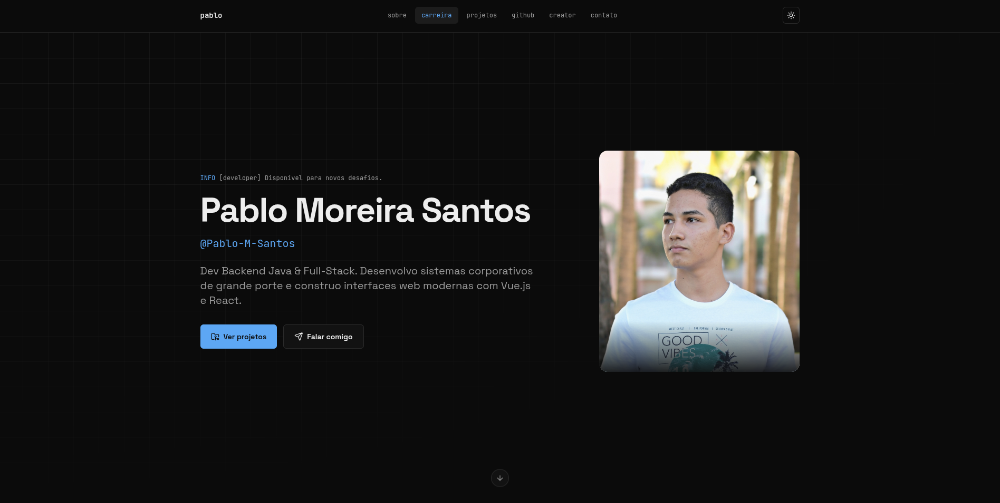

<p align="center">
  
</p>

<h1 align="center">Pablo Moreira Santos · Portfólio</h1>

<p align="center">
  Portfólio pessoal de um desenvolvedor Backend Java & Full-Stack, apresentado como uma interface inspirada em terminal, Git e ferramentas de desenvolvimento.
</p>

<p align="center">
  <a href="https://github.com/Pablo-M-Santos">GitHub</a> ·
  <a href="https://linkedin.com/in/pablo-m-santos">LinkedIn</a>
</p>

---

## Sobre o projeto

Este projeto é o portfólio pessoal de **Pablo Moreira Santos**, desenvolvido para apresentar trajetória profissional, tecnologias, formação, contribuições e formas de contato em uma experiência visual própria.

A interface combina uma estética de ferramenta de desenvolvimento com uma navegação simples e responsiva. A carreira é apresentada como uma sequência de commits, as informações profissionais são organizadas como uma ficha técnica e os contatos aparecem como comandos de terminal.

### Objetivos

- Apresentar a experiência profissional de forma clara e memorável.
- Centralizar conhecimentos técnicos, formação e canais de contato.
- Demonstrar domínio de React, TypeScript, CSS moderno e boas práticas de componentização.
- Oferecer uma experiência responsiva em dispositivos móveis e desktops.
- Manter o conteúdo fácil de atualizar sem espalhar textos pelos componentes.

## Sumário

1. [Sobre o projeto](#sobre-o-projeto)
2. [Funcionalidades](#funcionalidades)
3. [Arquitetura](#arquitetura)
4. [Stack tecnológica](#stack-tecnológica)
5. [Estrutura de pastas](#estrutura-de-pastas)
6. [Organização do conteúdo](#organização-do-conteúdo)
7. [Experiência e interface](#experiência-e-interface)
8. [Pré-requisitos](#pré-requisitos)
9. [Instalação e execução](#instalação-e-execução)
10. [Scripts disponíveis](#scripts-disponíveis)
11. [Build e deploy](#build-e-deploy)
12. [Personalização](#personalização)
13. [Roadmap](#roadmap)
14. [Contato](#contato)

## Funcionalidades

### Navegação

- Header fixo durante a rolagem.
- Navegação por âncoras entre as seções.
- Indicador visual da seção ativa.
- Menu mobile colapsável.
- Rolagem suave entre seções.

### Tema

- Tema escuro como padrão.
- Alternância entre tema escuro e claro.
- Preferência persistida em `localStorage`.
- Atualização do `data-theme` no elemento `<html>`.
- Cores centralizadas em variáveis do Tailwind CSS.

### Apresentação profissional

- Hero com nome, cargo, disponibilidade e foto.
- Resumo profissional e ficha técnica.
- Grupos de tecnologias e ferramentas.
- Formação acadêmica e técnica.
- Idiomas.
- Estatísticas profissionais.

### Linha do tempo de carreira

A seção de carreira utiliza uma representação visual inspirada em Git:

- Cada experiência é apresentada como um commit.
- Exibe empresa, cargo, período, localização e tecnologias.
- Detalhes da experiência aparecem como alterações de um commit.
- Os itens são revelados conforme entram na viewport.

### GitHub

A seção de GitHub apresenta:

- Total de contribuições.
- Dias ativos.
- Maior sequência de dias.
- Melhor dia de contribuições.
- Totais mensais.
- Heatmap anual de atividade.

Os dados são carregados pela API pública `github-contributions-api.jogruber.de`. Enquanto a requisição é processada ou caso a API esteja indisponível, a interface possui valores de fallback para preservar a experiência visual.

### Contato

- Cópia do e-mail usando a Clipboard API do navegador.
- Links diretos para GitHub e LinkedIn.
- Link telefônico para contato pelo celular.
- Feedback visual após copiar o e-mail.

### Identidade visual

- Favicon personalizado com as iniciais `PS`.
- Tipografia `Space Grotesk`, `JetBrains Mono` e `Inter`.
- Interface inspirada em terminal, código e versionamento.
- Paleta escura com azul como cor de destaque.
- Imagens de apresentação e screenshots organizadas em `src/assets/img`.

## Arquitetura

O projeto é uma **Single Page Application (SPA)** renderizada no cliente.

```text
┌────────────────────────────────────────────────────────────┐
│                         React SPA                          │
│                                                            │
│  App                                                       │
│   ├── Header                                               │
│   ├── Hero                                                 │
│   ├── Stats                                                │
│   ├── About                                                │
│   ├── Career                                               │
│   ├── Projects                                             │
│   ├── Github                                               │
│   ├── Creator                                              │
│   ├── Contact                                              │
│   └── Footer                                               │
│                                                            │
│  Conteúdo: src/data.ts                                     │
│  Estilos: src/style.css + Tailwind CSS                     │
└───────────────────────────┬────────────────────────────────┘
                            │
                            │ fetch
                            ▼
             github-contributions-api.jogruber.de
```

### Princípios utilizados

- **Componentização:** cada seção possui responsabilidade própria.
- **Dados separados da apresentação:** textos, links, experiências e tecnologias ficam em `src/data.ts`.
- **Tipagem estática:** interfaces e tipos compartilhados ficam em `src/types.ts`.
- **Progressive enhancement:** animações e dados externos enriquecem a experiência sem impedir o conteúdo principal.
- **Responsividade:** os componentes utilizam classes responsivas para adaptar a interface a diferentes larguras.
- **Acessibilidade básica:** uso de landmarks HTML, `aria-label`, textos alternativos, foco em botões e links semânticos.

## Stack tecnológica

| Tecnologia | Finalidade |
|---|---|
| React 19 | Construção da interface e dos componentes |
| TypeScript 7 | Tipagem estática e segurança durante o desenvolvimento |
| Vite 8 | Servidor de desenvolvimento e build de produção |
| Tailwind CSS 4 | Estilização utilitária e design responsivo |
| `@tailwindcss/vite` | Integração do Tailwind com o Vite |
| `@vitejs/plugin-react` | Suporte ao React no Vite |
| pnpm | Gerenciamento de dependências |
| Google Fonts | Tipografias Inter, JetBrains Mono e Space Grotesk |

## Estrutura de pastas

```text
Portfolio/
├── public/
│   └── favicon.svg              # Favicon com as iniciais PS
├── src/
│   ├── assets/
│   │   └── img/                 # Foto e imagens de apresentação
│   │       ├── carreira.png
│   │       ├── contato.png
│   │       ├── github.png
│   │       ├── pablo.png
│   │       ├── principal.png
│   │       └── sobre.png
│   ├── components/
│   │   ├── About.tsx            # Resumo, habilidades e formação
│   │   ├── Career.tsx           # Linha do tempo profissional
│   │   ├── Contact.tsx          # E-mail e links de contato
│   │   ├── Creator.tsx          # Seção sobre a criação do portfólio
│   │   ├── Footer.tsx           # Rodapé
│   │   ├── Github.tsx           # Contribuições do GitHub
│   │   ├── Header.tsx           # Navegação e alternância de tema
│   │   ├── Hero.tsx             # Apresentação inicial
│   │   ├── Icon.tsx             # Biblioteca de ícones SVG
│   │   ├── LinkButton.tsx       # Botões e links reutilizáveis
│   │   ├── LogLine.tsx          # Linha visual de terminal
│   │   ├── Projects.tsx         # Projetos em destaque
│   │   ├── RichText.tsx         # Renderização de destaques em Markdown simples
│   │   ├── Section.tsx          # Layout compartilhado das seções
│   │   ├── Stats.tsx            # Estatísticas profissionais
│   │   └── TagList.tsx           # Lista reutilizável de tecnologias
│   ├── App.tsx                  # Composição principal da página
│   ├── data.ts                  # Conteúdo do portfólio
│   ├── main.tsx                 # Ponto de entrada da aplicação
│   ├── style.css                # Tailwind, tokens e animações
│   └── types.ts                 # Tipos compartilhados
├── .gitignore
├── index.html                   # Metadados, título e favicon
├── package.json
├── pnpm-lock.yaml
├── vite.config.ts
└── README.md
```

## Organização do conteúdo

O conteúdo editável do portfólio fica concentrado em `src/data.ts`.

| Exportação | Conteúdo |
|---|---|
| `navItems` | Itens da navegação |
| `stats` | Estatísticas exibidas no resumo |
| `bio` | Parágrafos da apresentação |
| `skillGroups` | Grupos de tecnologias |
| `training` | Formação acadêmica e técnica |
| `languages` | Idiomas |
| `commits` | Experiências profissionais |
| `projects` | Projetos em destaque |
| `linkCards` | Cards de GitHub e LinkedIn |
| `contactCommands` | Comandos e links de contato |
| `EMAIL` | Endereço usado na seção de contato |

Para atualizar informações profissionais, prefira editar os dados nesse arquivo em vez de alterar o JSX dos componentes.

> Atualmente, `projects` está preparado para receber projetos em destaque, mas não possui itens cadastrados. A seção continua disponível para futuras inclusões.

## Experiência e interface

### Responsividade

A interface foi construída com abordagem responsiva:

- Layout em coluna única para telas pequenas.
- Grid com duas colunas para a apresentação em telas maiores.
- Menu de navegação mobile.
- Cards, tags e textos com espaçamentos adaptáveis.
- Imagens com `object-fit` para preservar a composição visual.

### Animações

As animações são ativadas principalmente com:

- `IntersectionObserver`, para revelar conteúdos quando entram na viewport.
- `requestAnimationFrame`, para animar contadores numéricos.
- Transições CSS em cards, botões e mudança de tema.
- Animação de carregamento da foto principal.

### Temas e tokens

Os tokens de cor estão definidos em `src/style.css`, incluindo:

- Fundo e superfícies.
- Texto principal e texto secundário.
- Bordas e linhas.
- Cor de destaque.
- Camadas de header e overlay.
- Grid de fundo.

Para ajustar a identidade visual, altere primeiro as variáveis em `@theme` e em `[data-theme="light"]`.

## Pré-requisitos

- Node.js `20.19+` ou `22.12+`.
- pnpm instalado.
- Navegador moderno com suporte a ES Modules, `IntersectionObserver` e Clipboard API.

## Instalação e execução

Clone o repositório:

```bash
git clone https://github.com/Pablo-M-Santos/Portfolio.git
cd Portfolio
```

Instale as dependências:

```bash
pnpm install
```

Inicie o servidor de desenvolvimento:

```bash
pnpm dev
```

O Vite exibirá no terminal o endereço local da aplicação. Como o script usa `--host`, a aplicação também pode ser acessada por outros dispositivos na mesma rede, quando permitido pelo ambiente.

## Scripts disponíveis

| Comando | Descrição |
|---|---|
| `pnpm dev` | Inicia o servidor de desenvolvimento do Vite |
| `pnpm build` | Gera a versão otimizada para produção em `dist/` |
| `pnpm preview` | Serve localmente o build de produção |

### Validação local

Depois de instalar as dependências, o build pode ser validado com:

```bash
pnpm build
```

Esse comando verifica a compilação TypeScript/React e gera os arquivos estáticos de produção.

## Build e deploy

O projeto gera uma aplicação estática, portanto pode ser hospedado em qualquer plataforma que sirva arquivos HTML, CSS e JavaScript.

### Build

```bash
pnpm build
```

Os arquivos finais são gerados em:

```text
dist/
```

### Plataformas compatíveis

- GitHub Pages.
- Vercel.
- Netlify.
- Cloudflare Pages.
- Firebase Hosting.
- Nginx ou qualquer servidor de arquivos estáticos.

### Configuração sugerida

- Comando de instalação: `pnpm install`
- Comando de build: `pnpm build`
- Diretório de saída: `dist`

Como a aplicação utiliza navegação por âncoras e não possui rotas internas do React, não é necessário configurar rewrites complexos para o funcionamento principal.

## Personalização

### Atualizar informações

Edite `src/data.ts` para alterar:

- Nome e descrição.
- Experiências profissionais.
- Tecnologias.
- Formação.
- Links sociais.
- Telefone e e-mail.
- Estatísticas.

### Alterar a foto

Substitua `src/assets/img/pablo.png` mantendo o mesmo caminho ou atualize o import em `src/components/Hero.tsx`.

### Adicionar um projeto

Inclua um objeto no array `projects` em `src/data.ts` seguindo o tipo `Project`:

```ts
{
  number: "01",
  icon: "folder",
  title: "Nome do projeto",
  description: "Descrição curta do projeto.",
  primaryLabel: "Destaques",
  primaryTags: ["React", "TypeScript"],
  stack: ["Vite", "Tailwind CSS"],
  cta: "Ver projeto",
  href: "https://exemplo.com",
  image: {
    src: imagemDoProjeto,
    alt: "Descrição acessível da imagem",
  },
  mediaClassName: "bg-surface",
  mediaFirst: true,
}
```

Para imagens importadas pelo Vite, adicione o import no início de `src/data.ts` e use a referência importada no campo `image.src`.

### Alterar o favicon

O favicon está em `public/favicon.svg` e é referenciado pelo `index.html`. O arquivo atual utiliza as iniciais `PS`, representando Pablo Santos.

## Roadmap

- [ ] Cadastrar projetos em destaque no array `projects`.
- [ ] Adicionar uma página ou seção detalhada para cada projeto.
- [ ] Incluir screenshots adicionais com descrições acessíveis.
- [ ] Adicionar validação automatizada de links externos.
- [ ] Criar testes de componentes e fluxos principais.
- [ ] Avaliar PWA e instalação como aplicativo.
- [ ] Melhorar o tratamento visual de indisponibilidade da API do GitHub.
- [ ] Adicionar metadados Open Graph e Twitter Card.
- [ ] Adicionar favicon em formatos complementares para maior compatibilidade.

## Contato

**Pablo Moreira Santos**

- GitHub: [@Pablo-M-Santos](https://github.com/Pablo-M-Santos)
- LinkedIn: [in/pablo-m-santos](https://linkedin.com/in/pablo-m-santos)
- E-mail: [pablomoreirasantos.hp@gmail.com](mailto:pablomoreirasantos.hp@gmail.com)
- Telefone: [+55 (85) 99282-2527](tel:+5585992822527)

## Licença

Este projeto é um portfólio pessoal. O código pode ser consultado como referência, mas textos, imagens, identidade visual e dados profissionais pertencem ao autor.
